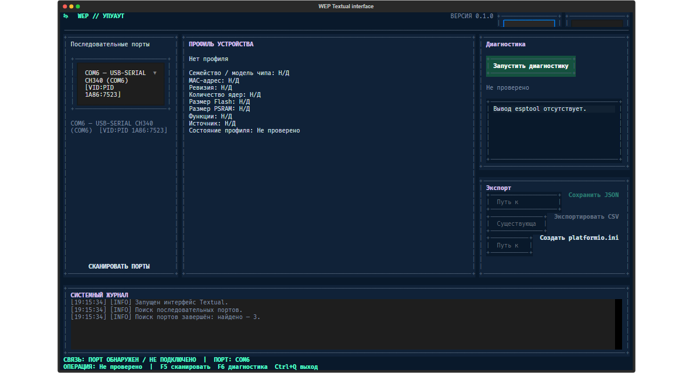

# WEP // WEPWAWET ESP32 PROFILER

WEP is a Windows desktop application for discovering serial ports, requesting
basic identification data from ESP32 devices, and saving an inspection profile.
It is a practical diagnostic aid, not a universal board or peripheral
autodetector.



This is a screenshot of the running application. The visible serial-port list
is specific to the capture computer and will differ on other systems.

## Features

- Discover and refresh serial ports reported by Windows.
- Run esptool's read-only `read-mac` operation to obtain chip type and MAC.
- Keep raw diagnostic output and distinguish successful, partial, and failed
  results.
- Save profiles as JSON and export CSV tables.
- Generate the current starter `platformio.ini`.
- Switch the UI between English and Russian and between dark and light themes.

The current diagnostic does not read or write flash, identify the exact
development board, discover peripherals, or measure PSRAM and electrical
properties. The generated PlatformIO configuration is a template and must be
reviewed for the target hardware.

## Requirements

- Windows 10 or Windows 11, x64 (Windows 11 has not been verified in the
  current validation).
- Python 3.11 or newer for source use; Python 3.14.2 was used for the verified
  Windows build.
- Tkinter/Tcl-Tk, included with the standard Windows Python installer.
- Runtime packages listed in `requirements.txt`: pySerial and esptool.
- Optional Textual prototype dependency in `requirements-textual.txt`; it is
  not required for the Tkinter application.
- PyInstaller 6.22.3 for the verified executable build; it is a separate build
  dependency and is not listed in `requirements.txt`.

## Set up on Windows

From PowerShell at the repository root:

```powershell
py -3.14 -m venv .venv
.\.venv\Scripts\python.exe -m pip install -r requirements.txt
```

The commands use Python 3.14 to match the verified environment. A Python 3.11+
interpreter may be used for source execution; compatibility of other Python and
PyInstaller combinations has not been certified here.

PyInstaller is not needed to run WEP from source. To build the EXE, install the
verified build tool separately into `.venv`:

```powershell
.\.venv\Scripts\python.exe -m pip install PyInstaller==6.22.3
```

## Run from source

```powershell
.\.venv\Scripts\python.exe run_wep.py
```

The experimental Textual interface uses a separate dependency set and entry
point. Install and run it with:

```powershell
.\.venv\Scripts\python.exe -m pip install -r requirements-textual.txt
.\.venv\Scripts\python.exe run_wep_textual.py
```

The default `run_wep.py` entry point continues to launch Tkinter. The Textual
prototype is not included in the Windows EXE build.
In the Textual export panel, enter a JSON or INI file path and an existing CSV
directory; an omitted `.json` or `.ini` suffix is appended. Replacing existing
outputs requires confirmation.

## Build the Windows EXE

Build from the repository root and select fresh output directories if the
example directories already contain another contributor's results:

```powershell
$distPath = 'dist\WEP_Redesign'
$workPath = 'build\WEP_Redesign'
if (Test-Path $distPath) {
    throw "Build output already exists: $distPath. Choose an unused path."
}
if (Test-Path $workPath) {
    throw "Build work directory already exists: $workPath. Choose an unused path."
}
.\.venv\Scripts\python.exe -m PyInstaller --noconfirm --distpath $distPath --workpath $workPath WEP_Copilot.spec
```

The verified build produced `dist\WEP_Redesign\WEP.exe` with PyInstaller
6.22.3. The spec builds a one-file executable. Launch the EXE and confirm the
GUI opens; build completion alone is not a runtime check.

## Connect and diagnose an ESP32

Connect the board, close other applications using its serial port, refresh the
port list, confirm the selected COM port, and start diagnostics. esptool may
reset the board. The GUI uses `default-reset` before and `hard-reset` after
`read-mac`; some hardware may require manual BOOT/RESET. No physical-device
diagnostic is implied by the automated tests or build validation.

The results include only values actually read by the diagnostic. See
[Diagnostics](./docs/DIAGNOSTICS.md) for statuses, errors, timeouts, and reset
behavior.

## Reports and configuration

Save JSON for the current profile, export CSV to an existing directory
(`profiles.csv`, `devices.csv`, and `observations.csv`), or generate a
`platformio.ini`. The current PlatformIO output contains a predefined
`RONGO_node` environment and `board = esp32dev`; verify it against the actual
board before building firmware.

## Tests

```powershell
.\.venv\Scripts\python.exe -m unittest discover -s tests -v
```

Tests use mocks for serial ports and diagnostic processes. They do not prove
that a physical ESP32 can connect or enter its bootloader automatically. No
linter or formatter is currently configured in the repository. Textual
interface tests run when the optional Textual dependencies are installed and
are skipped otherwise.

## Project structure

```text
run_wep.py
run_wep_textual.py
WEP_Copilot.spec
requirements.txt
requirements-textual.txt
src/wep/
  __init__.py
  __main__.py
  gui.py
  textual_app.py
  textual_app.tcss
  esptool_diagnostics.py
  serial_ports.py
  profile.py
  profile_factory.py
  storage.py
  csv_export.py
  platformio_ini.py
  settings.py
  localization.py
  version.py
  assets/
tests/
docs/
```

## Documentation

- [Architecture](./docs/ARCHITECTURE.md)
- [Development and build](./docs/DEVELOPMENT.md)
- [User guide](./docs/USER_GUIDE.md)
- [Diagnostics](./docs/DIAGNOSTICS.md)
- [Contributing](./CONTRIBUTING.md)
- [Changelog](./CHANGELOG.md)
- [Русская версия README](./README.ru.md)

## License

The repository includes an [MIT License](./LICENSE). Copyright notice:
nicodim4-droid, 2026.
