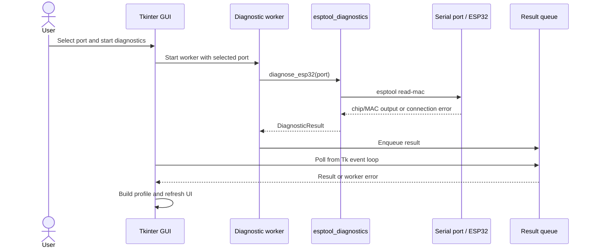

# Architecture

WEP is a Windows desktop application for discovering serial ports, reading a
small set of ESP32 identification data with esptool, and saving an inspection
profile. The default GUI is implemented with Python's standard-library Tkinter and ttk.
An optional Textual prototype uses the same hardware, data, persistence,
export, settings, and translation modules under `src/wep/`.

## Module map

| Module | Responsibility |
| --- | --- |
| `run_wep.py` | Source-checkout entry point; adds `src` to the import path, enables multiprocessing support for frozen builds, and starts the package. |
| `run_wep_textual.py` | Separate source-checkout entry point for the optional Textual prototype. |
| `src/wep/__main__.py` | Calls the GUI entry point when WEP is run as a module or packaged application. |
| `src/wep/gui.py` | Tkinter window, UI state, user actions, worker-thread coordination, profile presentation, and localized copy/report text. |
| `src/wep/textual_app.py` | Experimental terminal UI, port selection, diagnostic worker, event log, settings controls, and calls to existing save/export functions. |
| `src/wep/textual_app.tcss` | Shared dark/light Alien-terminal styling and responsive panel layout for Textual. |
| `src/wep/serial_ports.py` | Lists serial ports using pySerial; it does not identify the connected board model. |
| `src/wep/esptool_diagnostics.py` | Runs the read-only esptool identification command, applies timeouts, captures output, and maps it to a structured diagnostic result. |
| `src/wep/profile.py` | Profile and observation data classes, provenance/confidence values, and schema version. |
| `src/wep/profile_factory.py` | Shared conversion of a diagnostic result into an inspection profile for both interfaces. |
| `src/wep/storage.py` | UTF-8 JSON profile serialization and validation. |
| `src/wep/csv_export.py` | Writes a profile as `profiles.csv`, `devices.csv`, and `observations.csv`. |
| `src/wep/platformio_ini.py` | Produces and saves the application's current starter PlatformIO configuration. |
| `src/wep/settings.py` | Reads and writes the selected language and theme under the current user's local application data directory. |
| `src/wep/localization.py` | RU/EN UI strings, formatting, and translation of known application messages. |
| `src/wep/version.py` | Application version value used in the interface. |
| `src/wep/assets/` | WEP symbol source image, PNG used by Tkinter, and Windows ICO resource. |
| `WEP_Copilot.spec` | PyInstaller analysis, hidden imports, esptool stub data, image resources, and EXE options. |

## Diagnostic data flow

The GUI scans ports through `serial_ports.py`. A selected port is passed to a
background worker, which calls `diagnose_esp32()`. The diagnostic command uses
esptool's `read-mac` operation and parses the chip type and MAC from esptool
output. It does not read or write flash.

The worker thread does not update Tk widgets. It puts the result or captured
exception in a `queue.Queue`; a periodic callback on the Tk event loop consumes
the queue and updates the interface. This keeps serial I/O out of the GUI
thread while preserving Tk's single-threaded widget access.

## Diagnostic process and reset behavior

In a normal Python run, esptool is launched as a Python module in a child
process. In a PyInstaller build, `sys.executable` identifies the WEP EXE, not a
separate Python interpreter. The frozen path therefore invokes the esptool API
in a spawned child process. Output and exceptions are captured in that process
and returned to the parent through a pipe. The parent enforces a 20-second
diagnostic deadline and attempts to terminate a child that exceeds it; a
separate two-second bound is used when waiting for termination.

The GUI calls diagnostics without the optional `manual_bootloader` argument.
Accordingly, it requests esptool's `default-reset` before the operation and
`hard-reset` afterward. The diagnostic module also supports a `no-reset` mode
for callers that have already put a board into its bootloader, but the GUI does
not currently expose that mode. Whether automatic reset enters the bootloader
depends on the board, USB-to-UART bridge, wiring, and port configuration; the
source code alone cannot establish the cause of a particular board's behavior.

## Result model and persistence

`DiagnosticResult` separates the selected port, status, chip type, MAC address,
raw esptool output, and a structured error when present. While building an
`InspectionProfile`, the GUI classifies the diagnostic error into profile
warnings or errors; profile fields retain source and confidence metadata. A
failed or partial diagnostic is not represented as a confirmed successful
inspection.

JSON persistence uses schema version 2 and validates required fields,
timestamps, UUIDs, and observed-value metadata when loading. CSV export creates
three UTF-8-with-BOM files in an existing destination directory. The CSV
columns preserve profile identifiers and observation provenance/confidence.

The PlatformIO generator currently returns a fixed starter configuration named
`RONGO_node`, including `board = esp32dev` and preselected libraries. It does
not infer a board identifier from the detected chip. Review and edit the
generated file for the actual board and project before using it to build
firmware.

## Settings, localization, and UI

The settings module stores language and theme in
`%LOCALAPPDATA%\WEP\settings.json` on Windows. English is the default language;
Russian and English can be selected in the GUI. Dark and light themes are
available. UI labels, statuses, and application-generated report text use the
central translation table. Raw output from esptool remains diagnostic output
and may use esptool's own wording.

## Application and Windows build entry points

`run_wep.py` is the source-checkout entry point. It adds the `src` directory to
`sys.path`, invokes `multiprocessing.freeze_support()`, and starts `wep`.
`src/wep/__main__.py` calls the GUI's `main()` function.

`WEP_Copilot.spec` sets `src` as a PyInstaller search path, includes package
imports, collects JSON data from esptool's
`targets/stub_flasher/` package directory, and packages the WEP image assets.
The resulting application is a windowed `WEP.exe`. See
[Development](./DEVELOPMENT.md) for the verified command and environment.

The Textual prototype has a separate `run_wep_textual.py` entry point and an
optional `requirements-textual.txt` dependency set. It does not replace the
Tkinter entry point and is not included in the current EXE specification.
Textual runs `diagnose_esp32()` in a thread worker; the diagnostic module keeps
ownership of the serial/esptool behavior and its timeout. The terminal screen
shows a confirmed response separately from a persistent connection, which the
current one-shot diagnostic does not provide.

## Boundaries and current limitations

- Port discovery reports port identifiers and descriptions; it cannot confirm
  a specific attached board.
- Diagnostics request chip type and MAC only; they do not inspect flash,
  connected peripherals, electrical characteristics, or firmware contents.
- No automatic peripheral-identification or board-selection database is
  provided.
- A successful host-side build does not prove that every board can enter the
  bootloader automatically. Physical-device checks are separate.
