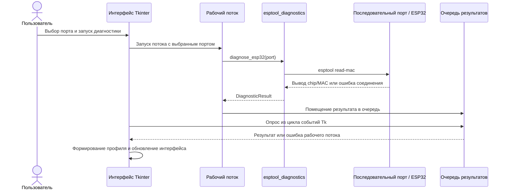

# Архитектура

WEP — настольное приложение Windows для поиска последовательных портов,
получения ограниченного набора идентификационных данных ESP32 через esptool и
сохранения профиля осмотра. Графический интерфейс реализован стандартными
библиотеками Python Tkinter и ttk. Диагностика, модели данных, хранение,
экспорт, настройки и переводы разделены по модулям в `src/wep/`.

## Карта модулей

| Модуль | Назначение |
| --- | --- |
| `run_wep.py` | Точка входа из исходников: добавляет `src` в путь импорта, включает поддержку multiprocessing для frozen-сборок и запускает пакет. |
| `src/wep/__main__.py` | Вызывает точку входа GUI при запуске WEP как модуля или упакованного приложения. |
| `src/wep/gui.py` | Окно Tkinter, состояние интерфейса, действия пользователя, взаимодействие с рабочим потоком, представление профиля и локализованный текст отчёта/копирования. |
| `src/wep/serial_ports.py` | Получает список последовательных портов через pySerial; не определяет модель подключённой платы. |
| `src/wep/esptool_diagnostics.py` | Выполняет команду идентификации esptool только для чтения, ограничивает время выполнения, захватывает вывод и формирует структурированный результат диагностики. |
| `src/wep/profile.py` | Классы профиля и наблюдений, значения происхождения/достоверности и версия схемы. |
| `src/wep/storage.py` | Сериализация профиля в UTF-8 JSON и проверка данных при чтении. |
| `src/wep/csv_export.py` | Записывает профиль в `profiles.csv`, `devices.csv` и `observations.csv`. |
| `src/wep/platformio_ini.py` | Формирует и сохраняет текущую начальную конфигурацию PlatformIO. |
| `src/wep/settings.py` | Читает и сохраняет выбранные язык и тему в локальном каталоге данных пользователя. |
| `src/wep/localization.py` | Строки интерфейса RU/EN, форматирование и перевод известных сообщений приложения. |
| `src/wep/version.py` | Значение версии приложения, используемое интерфейсом. |
| `src/wep/assets/` | Исходное изображение символа WEP, PNG для Tkinter и ресурс ICO для Windows. |
| `WEP_Copilot.spec` | Анализ PyInstaller, скрытые импорты, данные esptool stub, изображения и параметры EXE. |

## Поток диагностических данных

GUI получает список портов через `serial_ports.py`. Выбранный порт передаётся
рабочему потоку, который вызывает `diagnose_esp32()`. Команда диагностики
использует операцию esptool `read-mac` и извлекает из вывода тип чипа и MAC.
Она не читает и не записывает flash.

Рабочий поток не изменяет виджеты Tk. Он помещает результат или перехваченное
исключение в `queue.Queue`; периодический обработчик цикла Tk забирает данные и
обновляет интерфейс. Это не блокирует GUI операциями с последовательным портом
и сохраняет правило доступа к виджетам Tk только из GUI-потока.

## Процесс диагностики и сброс

При запуске обычным Python esptool запускается как модуль Python в дочернем
процессе. В PyInstaller `sys.executable` указывает на EXE WEP, а не на отдельный
интерпретатор Python. Поэтому frozen-режим вызывает API esptool в дочернем
процессе, созданном методом spawn. Вывод и исключения перехватываются там и
возвращаются родительскому процессу через канал связи. Родитель ограничивает
диагностику 20 секундами и пытается остановить превысивший срок дочерний
процесс; ожидание остановки дополнительно ограничено двумя секундами.

GUI вызывает диагностику без необязательного аргумента `manual_bootloader`.
Следовательно, перед операцией запрашивается `default-reset` esptool, а после
неё — `hard-reset`. Модуль диагностики также поддерживает режим `no-reset` для
вызывающих сторон, которые уже перевели плату в загрузчик, но в GUI этот режим
сейчас не доступен. Успешность автоматического сброса зависит от платы,
USB-UART-моста, разводки и конфигурации порта; по одним исходникам нельзя
установить причину поведения конкретной платы.

## Модель результата и хранение

`DiagnosticResult` отдельно хранит выбранный порт, статус, тип чипа, MAC,
исходный вывод esptool и структурированную ошибку, если она есть. При создании
`InspectionProfile` GUI классифицирует ошибку диагностики как предупреждение
или ошибку профиля; поля профиля сохраняют источник и уровень достоверности.
Неуспешная или частичная диагностика не представляется подтверждённым
успешным осмотром.

JSON хранится по схеме версии 2. При чтении проверяются обязательные поля,
временные метки, UUID и метаданные наблюдаемых значений. CSV-экспорт создаёт
три файла UTF-8 с BOM в уже существующей папке назначения. Столбцы CSV
сохраняют идентификаторы профиля, происхождение и достоверность наблюдений.

Генератор PlatformIO сейчас возвращает фиксированную начальную конфигурацию
`RONGO_node`, в том числе `board = esp32dev` и выбранные библиотеки. Он не
выводит идентификатор платы из обнаруженной модели чипа. Перед использованием
конфигурации для сборки прошивки проверьте и отредактируйте её с учётом
фактической платы и проекта.

## Настройки, локализация и интерфейс

На Windows настройки хранятся в `%LOCALAPPDATA%\WEP\settings.json`. По
умолчанию выбран английский язык; в GUI доступны русский и английский. Также
доступны тёмная и светлая темы. Подписи, состояния и сформированный приложением
текст отчёта используют общую таблицу переводов. Исходный вывод esptool
остаётся диагностическим текстом и может содержать формулировки самого esptool.

## Точки входа и сборка Windows

`run_wep.py` — точка входа из исходников. Он добавляет каталог `src` в
`sys.path`, вызывает `multiprocessing.freeze_support()` и запускает `wep`.
`src/wep/__main__.py` вызывает `main()` графического интерфейса.

`WEP_Copilot.spec` задаёт `src` как путь поиска PyInstaller, включает импорты
пакетов, собирает JSON-данные из каталога пакета esptool
`targets/stub_flasher/` и добавляет графические ресурсы WEP. В результате
создаётся оконное приложение `WEP.exe`. Проверенную команду и окружение см. в
[документации разработки](./DEVELOPMENT.ru.md).

## Границы и текущие ограничения

- Поиск сообщает идентификаторы и описания портов, но не подтверждает модель
  подключённой платы.
- Диагностика запрашивает только тип чипа и MAC; она не проверяет flash,
  периферию, электрические параметры или содержимое прошивки.
- Автоматическое распознавание периферии и база точных моделей плат не
  реализованы.
- Успешная сборка на компьютере не доказывает, что любая плата автоматически
  войдёт в загрузчик. Проверка реального устройства выполняется отдельно.
